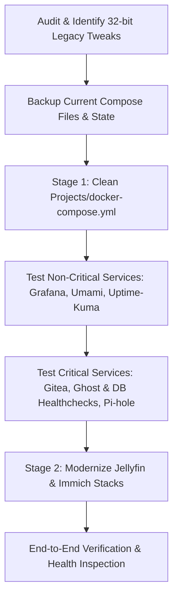

# Implementation Plan: Docker Compose 64-Bit Audit & Modernization

## Goal Description
Conduct a comprehensive audit and modernization of the Docker Compose configurations across the homelab infrastructure on a native 64-bit Raspberry Pi 5 (`aarch64`, Debian 13 Trixie, Docker 29.7.2, 8GB RAM). 

Previously, when running on a 32-bit OS (ARMv7), various legacy workarounds were necessary—such as disabling syscall security (`security_opt: [seccomp=unconfined]`), hardcoding architecture platform strings (`platform: linux/arm64/v8`), installing legacy plugins, and missing healthcheck dependencies. 

Because these services handle live production traffic (DNS, Git, Analytics, Blogs, Monitoring, Home Automation, Media), all updates must be performed with precision, zero data risk, and minimal downtime.

---

## User Review Required

> [!IMPORTANT]
> **Production Traffic Safeguards**: All persistent volumes, databases (`PostgreSQL 16`, `MySQL 8`, `immich_postgres`), and environment variables (`.env`) will remain completely untouched. Changes will be deployed service-by-service to verify stability without service disruption.

> [!NOTE]
> **Seccomp Hardening**: On 32-bit systems, `seccomp=unconfined` was necessary because old Docker/libseccomp blocked modern 64-bit syscalls (`clone3`, `clock_gettime64`, `fstatat64`). On 64-bit Debian 13 with Docker 29, Docker's default seccomp profile natively supports all standard 64-bit syscalls. Removing `seccomp=unconfined` re-enables container sandboxing.

---

## Audit Findings & Key Areas for Improvement

### 1. Security & 32-bit Legacy Workaround Cleanup
| Workaround | Affected Services | Issue on 32-bit vs. Reality on 64-bit Pi 5 | Action |
| :--- | :--- | :--- | :--- |
| `security_opt: - seccomp=unconfined` | `umami`, `ghost-db`, `gitea`, `jellyfin`, `immich-*`, `cdify-api` | 32-bit libseccomp blocked `clone3`/`clock_gettime64`. On 64-bit Trixie, default seccomp is fully compatible and secure. | **Remove `seccomp=unconfined`** to restore container isolation. |
| `platform: linux/arm64/v8` & `platform: linux/arm64` | `homeassistant`, `umami`, `ghost-db`, `gitea`, `jellyfin`, `immich-*` | 32-bit OS with 64-bit kernel required forcing arm64 platform. Native 64-bit OS automatically pulls native `linux/arm64`. | **Remove redundant `platform` tags** to let Docker handle native multi-arch manifests cleanly. |
| `SYS_TIME` capability in Pi-hole | `pihole` | `SYS_TIME` allows the container to alter the host's real-time clock. On host network mode, Pi 5 uses `systemd-timesyncd`. | **Remove `SYS_TIME`** unless Pi-hole is acting as an NTP server. |

### 2. Startup Resilience & Service Dependencies
- **`ghost` & `ghost-db` startup race**:
  - Currently: `ghost` specifies `depends_on: [ghost-db]`, but `ghost-db` (MySQL) has no healthcheck. After reboots or restarts, Ghost attempts to connect before MySQL has opened port 3306, causing crash loops.
  - Improvement: Add `mysqladmin ping` healthcheck to `ghost-db` and set `condition: service_healthy` on `ghost`.

### 3. Application Configuration Cleanup
- **Grafana AngularJS Plugin Warning**:
  - `GF_INSTALL_PLUGINS=grafana-clock-panel,grafana-simple-json-datasource`: Modern Grafana 12+ disables Angular plugins. `grafana-simple-json-datasource` throws error logs on every start.
  - Improvement: Remove `grafana-simple-json-datasource` from `GF_INSTALL_PLUGINS`.

### 4. Storage & Log Rotation Protection
- Currently, no log limits are configured in Compose files or `/etc/docker/daemon.json`. Containers like `immich_postgres` can generate massive log files on NVMe storage.
- Improvement: Add standard Docker log rotation (`json-file`, `max-size: 20m`, `max-file: 3`) either centrally or in compose services.

---

## Proposed Changes



---

### Component 1: Main Homelab Stack (`Projects/docker-compose.yml`)

#### [MODIFY] `Projects/docker-compose.yml`

```diff
 services:
   pihole:
     container_name: pihole
     image: pihole/pihole@sha256:91dc91ddd413bf461c283204558f8f21839851e9824799075a7ceff7c77eea40
     network_mode: "host"
     environment:
       TZ: 'Europe/Warsaw'
       FTLCONF_webserver_api_password: '${PIHOLE_WEB_PASSWORD}'
       FTLCONF_dns_listeningMode: 'all'
     volumes:
       - './etc-pihole:/etc/pihole'
     cap_add:
       - NET_ADMIN
-      - SYS_TIME
       - SYS_NICE
     restart: unless-stopped
 
   navidrome:
     image: deluan/navidrome:0.59.0@sha256:4edc8a1de3e042f30b78a478325839f4395177eb8201c27543dccc0eba674f23
     user: 1000:1000
     ports:
       - "4533:4533"
     restart: unless-stopped
     environment:
       ND_SCANSCHEDULE: 1h
       ND_LOGLEVEL: info
       ND_SESSIONTIMEOUT: 24h
       ND_BASEURL: ""
     volumes:
       - "./navidrome/data:/data"
       - "./navidrome/music:/music:ro"
 
   grafana:
     image: grafana/grafana@sha256:adaf2d6b44c7e2b711b931b98be153778d313806582a24eab21178804fac2976
     container_name: grafana
     restart: always
     ports:
       - "3000:3000"
     volumes:
       - ./grafana/data:/var/lib/grafana
       - ./grafana/grafana.ini:/etc/grafana/grafana.ini
       - ./grafana/provisioning:/etc/grafana/provisioning
     environment:
-      - GF_INSTALL_PLUGINS=grafana-clock-panel,grafana-simple-json-datasource
+      - GF_INSTALL_PLUGINS=grafana-clock-panel
       - GF_SECURITY_ADMIN_USER=${GF_SECURITY_ADMIN_USER}
       - GF_SECURITY_ADMIN_PASSWORD=${GF_SECURITY_ADMIN_PASSWORD}
     networks:
       - monitoring
 
   prometheus:
     container_name: prometheus
     image: prom/prometheus@sha256:e4254400b85610324913f0dc4acf92603d9984e7519414c5a12811aa6146acc3
     ports:
       - "9090:9090"
     volumes:
       - ~/projects/prometheus/prometheus.yml:/etc/prometheus/prometheus.yml:ro
       - ~/projects/prometheus/data:/prometheus
     user: "1000:1000"
     command:
       - '--storage.tsdb.retention.time=30d'
       - '--config.file=/etc/prometheus/prometheus.yml'
       - '--storage.tsdb.path=/prometheus'
     restart: unless-stopped
     networks:
       - monitoring
 
   homeassistant:
-    platform: linux/arm64/v8
     container_name: homeassistant
     image: ghcr.io/home-assistant/home-assistant@sha256:c9da2a0a5738ceb26e1b4f672825c09371e51ae5e285beffa3072757b7817f3e
     volumes:
       - ~/projects/homeassistant/config:/config
       - /etc/localtime:/etc/localtime:ro
       - /run/dbus:/run/dbus:ro
     restart: unless-stopped
     privileged: true
     network_mode: host
 
   umami:
     image: ghcr.io/umami-software/umami@sha256:28f263fe06f79ebffa5a6a6e9bd33b7a278e9342a88e0bdac812416c9f9e4361
-    platform: linux/arm64/v8
-    security_opt:
-      - seccomp=unconfined
     ports:
       - "3001:3000"
     environment:
       DATABASE_URL: postgresql://umami:${UMAMI_DB_PASSWORD}@db:5432/umami
       DATABASE_TYPE: postgresql
       APP_SECRET: ${UMAMI_APP_SECRET}
       TRACKER_SCRIPT_NAME: x
     depends_on:
       db:
         condition: service_healthy
     init: true
     restart: always
     healthcheck:
       test: ["CMD-SHELL", "curl http://localhost:3000/api/heartbeat"]
       interval: 5s
       timeout: 5s
       retries: 5
     networks:
       - backend
 
   db:
     image: postgres:16@sha256:d4c3314b2dd74ff23cd6cd07e4d7e737cb6ef791c22a7cbd744cfbfb4815df72
     environment:
       POSTGRES_DB: umami
       POSTGRES_USER: umami
       POSTGRES_PASSWORD: ${UMAMI_DB_PASSWORD}
     volumes:
       - umami-db-data:/var/lib/postgresql/data
       - ./gitea/init-gitea-db.sh:/docker-entrypoint-initdb.d/init-gitea-db.sh
     restart: always
     healthcheck:
       test: ["CMD-SHELL", "pg_isready -U $${POSTGRES_USER} -d $${POSTGRES_DB}"]
       interval: 5s
       timeout: 5s
       retries: 5
     networks:
       - backend
 
   ghost:
     image: ghost:6
     container_name: ghost
     restart: unless-stopped
     ports:
       - "2368:2368"
     depends_on:
-      - ghost-db
+      ghost-db:
+        condition: service_healthy
     environment:
       url: https://blog.marzeta.pl
       mail__transport: SMTP
       mail__from: noreply@newsletter.marzeta.pl
       mail__options__service: Mailgun
       mail__options__host: smtp.eu.mailgun.org
       mail__options__port: 587
       mail__options__secure: "false"
       mail__options__auth__user: "blog@newsletter.marzeta.pl"
       mail__options__auth__pass: "${GHOST_MAILGUN_PASSWD}"
       database__client: mysql
       database__connection__host: ghost-db
       database__connection__user: ghostuser
       database__connection__password: "${GHOST_DB_PASSWORD}"
       database__connection__database: ghostdb
     volumes:
       - ./content:/var/lib/ghost/content
     networks:
       - ghost-net
 
   ghost-db:
     image: mysql@sha256:5cdee9be17b6b7c804980be29d1bb0ba1536c7afaaed679fe0c1578ea0e3c233
     restart: unless-stopped
-    platform: linux/arm64/v8
-    security_opt:
-      - seccomp=unconfined
     environment:
       MYSQL_ROOT_PASSWORD: "${MYSQL_ROOT_PASSWORD}"
       MYSQL_ROOT_HOST: '%'
       MYSQL_DATABASE: ghostdb
       MYSQL_USER: ghostuser
       MYSQL_PASSWORD: "${GHOST_DB_PASSWORD}"
     volumes:
       - ghost-db-data:/var/lib/mysql
+    healthcheck:
+      test: ["CMD", "mysqladmin", "ping", "-h", "127.0.0.1", "-u", "ghostuser", "--password=${GHOST_DB_PASSWORD}"]
+      interval: 10s
+      timeout: 5s
+      retries: 5
+      start_period: 10s
     networks:
       - ghost-net
 
   uptime-kuma:
     image: louislam/uptime-kuma@sha256:3d632903e6af34139a37f18055c4f1bfd9b7205ae1138f1e5e8940ddc1d176f9
     container_name: uptime-kuma
     ports:
       - "3003:3001"
     volumes:
       - ./uptime-kuma/data:/app/data
     restart: unless-stopped
 
   gitea:
     image: docker.gitea.com/gitea:1.26.1
     container_name: gitea
-    platform: linux/arm64
-    security_opt:
-      - seccomp=unconfined
     restart: unless-stopped
     environment:
       - USER_UID=1000
       - USER_GID=1000
       - GITEA__database__DB_TYPE=postgres
       - GITEA__database__HOST=db:5432
       - GITEA__database__NAME=gitea
       - GITEA__database__USER=gitea
       - GITEA__database__PASSWD=${GITEA_DB_PASSWORD}
       - GITEA__mailer__ENABLED=true
       - GITEA__mailer__FROM=git@newsletter.marzeta.pl
       - GITEA__mailer__PROTOCOL=smtp
       - GITEA__mailer__SMTP_ADDR=smtp.eu.mailgun.org
       - GITEA__mailer__SMTP_PORT=587
       - GITEA__mailer__USER=git@newsletter.marzeta.pl
       - GITEA__mailer__PASSWD=${GITEA_MAILGUN_PASSWD}
     volumes:
       - ./gitea/data:/data
       - /etc/timezone:/etc/timezone:ro
       - /etc/localtime:/etc/localtime:ro
     ports:
       - "3002:3000"
       - "222:22"
     depends_on:
       db:
         condition: service_healthy
     networks:
       - backend
```

---

### Component 2: Jellyfin & Immich Stacks (`Projects/jellyfin/` & `Projects/immich-app/`)

#### [MODIFY] `Projects/jellyfin/docker-compose.yml`
- Remove `platform: linux/arm64/v8` and `security_opt: [seccomp=unconfined]`.

#### [MODIFY] `Projects/immich-app/docker-compose.yml`
- Remove `platform: linux/arm64/v8` and `security_opt: [seccomp=unconfined]` from `immich-server`, `immich-machine-learning`, `redis`, and `database`.

---

## Safe Execution & Rollout Strategy

1. **Safety Backup**: Create timestamped backups of all compose files before any edits.
2. **Controlled Apply**: Apply changes stack-by-stack using `docker compose up -d <service>` or `docker compose up -d` without full teardowns.
3. **Log & Health Monitoring**: For each service, immediately inspect `docker inspect` health status and real-time logs (`docker logs --tail 50 <service>`) to verify no syscall exceptions or DB connectivity errors occur.
4. **Endpoint Validation**: Perform HTTP curl tests against all live endpoints (`Pi-hole`, `Grafana`, `Prometheus`, `Umami`, `Gitea`, `Ghost`, `Uptime Kuma`, `Jellyfin`, `Immich`).

---

## Verification Plan

### Automated Tests
- Validate Compose configuration syntax:
  ```bash
  docker compose -f ~/projects/docker-compose.yml config --quiet
  docker compose -f ~/projects/jellyfin/docker-compose.yml config --quiet
  docker compose -f ~/projects/immich-app/docker-compose.yml config --quiet
  ```
- Check all container health and HTTP responses:
  ```bash
  curl -fsSL http://localhost:3000/api/health      # Grafana
  curl -fsSL http://localhost:3001/api/heartbeat   # Umami
  curl -fsSL http://localhost:3002/                # Gitea
  curl -fsSL http://localhost:3003/                # Uptime Kuma
  curl -fsSL http://localhost:9090/-/healthy       # Prometheus
  curl -fsSL http://localhost:2368/                # Ghost
  curl -fsSL http://localhost:8096/health          # Jellyfin
  curl -fsSL http://localhost:2283/api/server/ping # Immich
  ```

### Manual Verification
- Confirm that existing dashboards, repositories, blog posts, and photo libraries load smoothly without latency or degradation.
- Confirm in `docker ps` that all containers report `healthy` or running.
