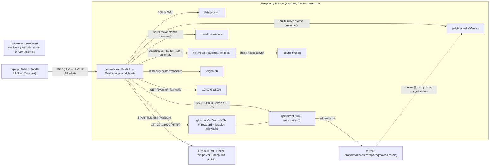
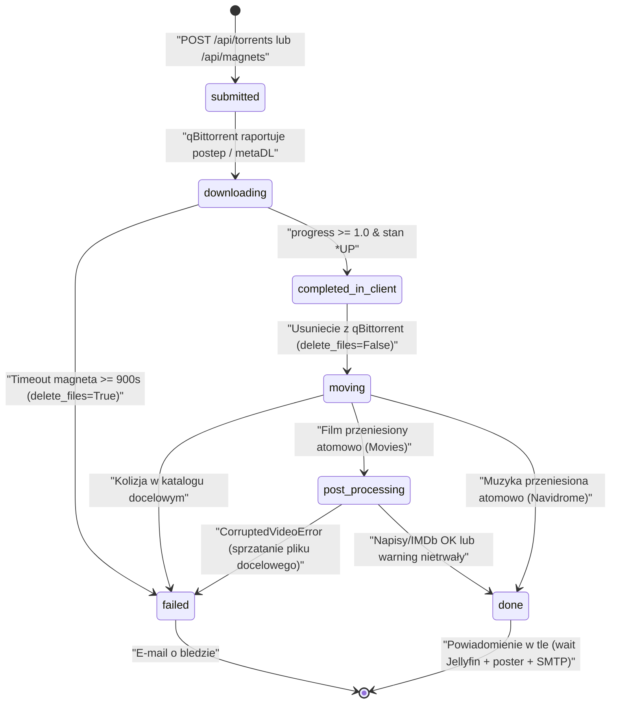

# `torrent-drop`: Podsumowanie architektury, decyzji i tradeoffów

Materiał podsumowujący architekturę systemu **torrent-drop** na Raspberry Pi (`aarch64`), podjęte decyzje projektowe, świadome kompromisy (tradeoffy) oraz problemy odkryte dopiero na styku z produkcją (Gluetun v3, qBittorrent v5, dual-stack IPv6 SLAAC, opóźnienia skanera Jellyfin). Dokument uzupełnia bazowe specyfikacje i plany wdrożenia jako gotowa baza pod artykuł blogowy.

---

## 1. Mapa artefaktów źródłowych (Specki, Plany, Kod)

- **Specyfikacja główna (v1):** [2026-11-13-vpn-torrent-drop-design.md](./specs-and-plans/2026-11-13-vpn-torrent-drop-design.md)
- **Plan wdrożenia (v1):** [2026-11-13-vpn-torrent-drop.md](./specs-and-plans/2026-11-13-vpn-torrent-drop.md)
- **Specyfikacja Magnet Links:** [2026-11-14-magnet-links-design.md](./specs-and-plans/2026-11-14-magnet-links-design.md)
- **Plan wdrożenia Magnet Links:** [2026-11-14-magnet-links.md](./specs-and-plans/2026-11-14-magnet-links.md)
- **Specyfikacja Rich HTML Emails:** [2026-11-14-rich-html-emails-design.md](./specs-and-plans/2026-11-14-rich-html-emails-design.md)
- **Kod aplikacji (~2 120 LOC Python + ~926 LOC UI):** `~/projects/torrent-drop/app/` ([main.py](./src/torrent-drop/app/main.py), [worker.py](./src/torrent-drop/app/worker.py), [notifier.py](./src/torrent-drop/app/notifier.py), [postprocess.py](./src/torrent-drop/app/postprocess.py), [db.py](./src/torrent-drop/app/db.py), [bencode.py](./src/torrent-drop/app/bencode.py), [torrent_client.py](./src/torrent-drop/app/torrent_client.py), [vpn_status.py](./src/torrent-drop/app/vpn_status.py), [config.py](./src/torrent-drop/app/config.py))
- **Testy (~3 200 LOC, 136 testów `pytest`):** `~/projects/torrent-drop/tests/`

---

## 2. Architektura wysokiego poziomu

System dzieli odpowiedzialność między **dwa izolowane kontenery Dockerowe** (ruch BitTorrent) oraz **lekki serwis hostowy `systemd`** (UI, kolejka SQLite, post-processing na tym samym systemie plików i integracja z Jellyfin/Mailgun):

### Kluczowe warstwy systemu

1. **Warstwa VPN i pobierania ([docker-compose.yml](./src/torrent-drop/docker-compose.yml)):**
   - `gluetun` (`qmcgaw/gluetun:v3`, Proton VPN przez WireGuard, `NET_ADMIN`, `/dev/net/tun`) zarządza tunelem i firewallem (`iptables` killswitch).
   - `qbittorrent` (`lscr.io/linuxserver/qbittorrent:latest`) działa w trybie `network_mode: "service:gluetun"` oraz `depends_on: gluetun: condition: service_healthy`. Nie ma własnego stosu sieciowego poza interfejsem tunelu i publikuje porty **wyłącznie na `127.0.0.1`** (`8085` dla Web API, `8000` dla serwera kontrolnego Gluetun).
2. **Warstwa API i kontroli dostępu ([main.py](./src/torrent-drop/app/main.py)):**
   - Aplikacja FastAPI działa na hoście jako usługa [torrent-drop.service](./src/torrent-drop/torrent-drop.service) na koncie `mmarzeta` (`1000:1000`).
   - Własne gniazdo dual-stack (`AF_INET6` z `IPV6_V6ONLY = 0` na `::8088`) obsługuje jednocześnie ruch IPv4 i IPv6.
   - Middleware `ip_allowlist_middleware` sprawdza bezpośredni `request.client.host` (ignorując nagłówki `X-Forwarded-For`), rozpakowuje adresy IPv4-mapped IPv6 (`::ffff:...`), wpuszcza wyłącznie sieci lokalne RFC1918, loopback, link-local, podsieci Tailscale (`100.64.0.0/10`, `fd7a:115c:a1e0::/48`) oraz dynamicznie wykryte globalne prefiksy IPv6 `/64` lokalnego hosta (`discover_host_ipv6_subnets`).
3. **Warstwa parsowania i walidacji ([bencode.py](./src/torrent-drop/app/bencode.py)):**
   - Własny dekoder bencode (~100 linii czystego Pythona bez zewnętrznych zależności C/wheel dla `aarch64`), liczący deterministyczny SHA-1 ze surowego zakresu bajtów klucza `info`.
   - Rozszerzony o `parse_magnet_uri` obsługujące linki `magnet:?xt=urn:btih:...` (zarówno 40-znakowy hex, jak i 32-znakowy Base32, a także linki hybrydowe v1+v2 z jawnym odrzuceniem v2-only `urn:btmh`).
4. **Warstwa trwałości stanu ([db.py](./src/torrent-drop/app/db.py)):**
   - SQLite w trybie `WAL` (`PRAGMA journal_mode = WAL`, `synchronous = NORMAL`) z blokadą `threading.Lock` chroniącą współbieżne odczyty z API i zapisy z workera.
   - Deduplikacja aktywnych zadań po `info_hash` w zbiorze `ACTIVE_STATES` (`submitted`, `downloading`, `completed_in_client`, `moving`, `post_processing`, `notifying`) — ponowne wrzucenie aktywnego torrenta lub magneta zwraca HTTP `409 Conflict`, ale ponowne wrzucenie po `done`/`failed` jest dozwolone.
5. **Worker i post-processing ([worker.py](./src/torrent-drop/app/worker.py), [postprocess.py](./src/torrent-drop/app/postprocess.py)):**
   - Pętla asynchroniczna co `3.0s` odpytuje qBittorrent, synchronizuje metadane (`name`, `total_size`) rozwiązanych magnetów, egzekwuje timeout dla martwych magnetów (`MAGNET_METADATA_TIMEOUT_SEC=900`), a po osiągnięciu `progress >= 1.0` natychmiast usuwa torrent z klienta (`delete_files=False` -> **zero seedowania**).
   - Przenosi payload atomowo (`shutil.move` na tej samej partycji NVMe `/dev/nvme0n1p2`), bez nadpisywania istniejących katalogów, a dla filmów uruchamia `fix_movies_subtitles_imdb.py --target ... --json-summary`.
6. **Warstwa powiadomień i integracji z Jellyfin ([notifier.py](./src/torrent-drop/app/notifier.py)):**
   - Wysyła maile `multipart/alternative` + `multipart/related` (HTML + fallback `text/plain` w języku polskim) przez Mailgun SMTP (`smtp.eu.mailgun.org:587`).
   - Osadza lokalny plakat (`folder.jpg`/`poster.jpg`) lub pobiera miniaturę z IMDb (`._V1_UX500_.jpg`), czeka w zadaniu w tle aż Jellyfin zaindeksuje nowy film w `jellyfin.db` i buduje bezpośredni deep-link `https://jellyfin.marzeta.pl/web/#/details?id=...&serverId=...`.

---

## 3. Maszyna stanów zadania (`JobStore`)

> [!NOTE]
> Zauważalna celowa właściwość w ostatniej fazie: zadanie przechodzi do stanu `done` **przed** wysłaniem powiadomienia e-mail. W trybie ciągłym `run_worker_loop` powiadomienie leci jako asynchroniczne zadanie w tle (`background_tasks`), więc oczekiwanie na skan Jellyfin (do ~88 s) nie zamraża aktualizacji paska postępu dla innych aktywnych torrentów.

---

## 4. Kluczowe decyzje architektoniczne i tradeoffy

| Decyzja | Wybrane rozwiązanie | Odrzucone alternatywy | Zysk (Dlaczego warto) | Koszt / Tradeoff |
| :--- | :--- | :--- | :--- | :--- |
| **Miejsce działania UI i workera** | Aplikacja FastAPI na **hoście (`systemd`)**, w kontenerach tylko `gluetun` + `qbittorrent` | Konteneryzacja aplikacji FastAPI i montowanie `/var/run/docker.sock` | Zero ekspozycji `docker.sock` kontenerom (ważne przy `fix_movies_subtitles_imdb.py` wołającym `docker exec jellyfin`); natychmiastowe atomowe `rename()` między `downloads/` a `jellyfin/media/Movies` na wspólnej partycji `/dev/nvme0n1p2` | Trzeba utrzymywać osobny unit `systemd` + lokalne `.venv` zamiast jednego `docker compose up` dla wszystkiego |
| **Izolacja VPN i brak GUI qBittorrent** | `gluetun` (WireGuard) + headless `qbittorrent` (`network_mode: service:gluetun`), WebUI spięte z `127.0.0.1` + własny frontend dropzone | 1) VPN na całym hoście Pi 2) Wystawienie natywnego WebUI qBittorrent | Reszta usług na Pi (`jellyfin`, `pihole`, `homeassistant`, `ssh`) działa bez zakłóceń na sieci domowej; killswitch w `iptables` kontenera daje twardą gwarancję braku wycieku; UX zredukowany do wrzucenia pliku/linku | Dodatkowy własny kod API i frontend (~1 300 LOC razem) zamiast gotowego UI |
| **Polityka zero-seedingu** | `max_ratio=0.0`, `max_ratio_act=0` (pauza po pobraniu) + natychmiastowe `delete_torrent(..., delete_files=False)` po `progress >= 1.0` | Utrzymywanie ratio `>= 1.0` lub usuwanie dopiero z crona | Spełnia wymóg prywatności i oszczędza pasmo/IOPS na Raspberry Pi; wyklucza konieczność przekierowania portów NAT-PMP (co upraszcza użycie szybszego i lżejszego na ARM WireGuarda) | Brak kompatybilności z prywatnymi trackerami wymagającymi seedowania; wymaga rygorystycznej weryfikacji stanu (`*UP`), by nie przenieść pliku w trakcie `checking` |
| **Bezpieczeństwo sieciowe UI (LAN + IPv6)** | Podwójny stos na `::8088` (`IPV6_V6ONLY=0`) + middleware sprawdzające `request.client.host` (RFC1918 + Tailscale + auto-wykrywanie `/64` IPv6 z `ip -6 -o addr`) | 1) Wystawienie za reverse proxy (Cloudflare/Nginx) z hasłem 2) Statyczna biała lista samego IPv4 | Zero logowania/haseł w przeglądarce domowej; odporność na spoofing `X-Forwarded-For`; działanie mimo zmiennych prefiksów IPv6 SLAAC nadawanych przez router/ISP | Jeśli host zmieni prefiks `/64` bez restartu `systemd`, nowe globalne IPv6 zostanie odrzucone (`403`) do czasu przeładowania usługi |
| **Obsługa błędów `fix_movies_subtitles_imdb.py`** | Rozróżnienie błędu krytycznego (`CorruptedVideoError` -> usunięcie pliku i `failed`) od awarii skryptu/API napisów (`returncode != 0`/timeout -> zostaw film, `done` + ostrzeżenie) | Traktowanie każdego błędu skryptu jako `failed` z kasowaniem wideo | Chwilowa awaria sieci, brak odpowiedzi NapiProjekt/IMDb lub pad demona Dockera **nie kasują** poprawnie pobranego filmu o wielkości kilku GB | Wymaga jawnego kontraktu JSON (`JSON_SUMMARY:{...}`) ze skryptu i dodatkowych testów regresyjnych |
| **Zakres skanu napisów (`--target`)** | Dodanie flagi `--target <path>` i `--json-summary` do istniejącego `fix_movies_subtitles_imdb.py` | Pełny skan całego `media/Movies` po każdym pobraniu | Unika wielominutowych opóźnień (w tym 15 s sleepów rate-limitu NapiProjekt na starszych filmach bez napisów) i pozwala przekazać bogate `movie_meta` do maila | Lekka modyfikacja istniejącego skryptu zewnętrznego (choć z zachowaniem pełnej kompatybilności wstecznej bez `--target`) |
| **Link bezpośredni do filmu w Jellyfin** | Odczyt `BaseItems` bezpośrednio z lokalnego pliku `jellyfin.db` w trybie **read-only (`?mode=ro`)** + `/System/Info/Public` po `127.0.0.1:8096` + polling w tle do ~88 s (`45 × 2s`) | Wymaganie i konfiguracja `JELLYFIN_API_KEY` oraz wyzwalanie skanu przez REST API | Zero dodatkowych tokenów w `.env`, działa na bieżącej bazie WAL Jellyfina bez jej blokowania i naturalnie czeka na zakończenie generowania `folder.jpg`/`movie.nfo` | Zależność od wewnętrznego schematu tabeli `BaseItems` w Jellyfinie oraz ~60-sekundowe opóźnienie wysłania maila po ukończeniu pobierania filmu (oczekiwanie na `LibraryMonitor`) |
| **Własny parser bencode i magnet** | ~220 linii czystego Pythona w `bencode.py` (obsługa bencode + `urn:btih:` hex/Base32 w `magnet:?`) | Zewnętrzna biblioteka (`bencodepy` / `torf` / `libtorrent`) | Brak problemów kompilacji natywnych rozszerzeń na `aarch64`, pełna kontrola nad walidacją uszkodzonych plików, limitami rozmiaru i błędami HTTP `400`/`413` | Brak wsparcia dla czystych magnetów BitTorrent v2 (`urn:btmh` bez `urn:btih`) oraz plików multi-line batch |
| **Obsługa magnetów bez migracji schematu** | Reużycie istniejącej kolumny `total_size = 0` jako sygnału braku metadanych; synchronizacja `name` i `total_size` po wyjściu z `metaDL` | Dodanie kolumn `source_type` / nowego stanu `resolving_metadata` | Zerowa migracja bazy SQLite, spójne API i UI zarówno dla `.torrent`, jak i `magnet:?`, oraz automatyczne czyszczenie martwych magnetów po `900s` | Zakłada, że prawdziwy torrent z `.torrent` zawsze ma `total_size > 0` |

---

## 5. Problemy odkryte w trakcie review i na produkcji ("Lesson Learned")

Te konkretne przypadki świetnie sprawdzą się w sekcji *"Co poszło nie tak i jak to naprawiliśmy"* na blogu:

1. **Gluetun v3 + qBittorrent v5 + interfejs `tun0` vs `wg0` (`9fb32b8`, `d43f8da`):**
   - Starsze endpointy statusu Gluetuna (`/v1/openvpn/status`) w nowszym `gluetun:v3` potrafią zwracać `404` — klient VPN sprawdza najpierw `/v1/vpn/status` i ma fallback na `/v1/openvpn/status`.
   - qBittorrent v5 przy `/api/v2/auth/login` zwraca czasem HTTP `204 No Content` zamiast `200`, co wcześniej mogło być mylnie interpretowane lub nieoczekiwane przy walidacji logowania.
   - Domyślną nazwę interfejsu w konfiguracji trzeba było skorygować z `wg0` na faktycznie obecny w kontenerze `tun0`.
2. **Niewidoczność usługi z laptopa na IPv6 (`1fcc9fb`):**
   - Uruchomienie Uvicorna wyłącznie na `0.0.0.0` lub z domyślnym `IPV6_V6ONLY=1` na Linuxie odcinało klientów próbujących połączyć się po lokalnym/globalnym IPv6. Ręczne utworzenie gniazda `AF_INET6` z `IPV6_V6ONLY = 0` i automatyczne wykrywanie prefiksów `/64` przez `ip -6 -o addr show scope global` rozwiązało problem bezpiecznie bez otwierania świata zewnętrznego.
3. **Ryzyko skasowania zdrowego filmu przy wyłączonym kontenerze `jellyfin` (`d43f8da`):**
   - Wcześniej błąd `docker exec jellyfin` w skrypcie sprawdzającym wideo mógł zostać odebrany jako uszkodzony plik wideo i wywołać jego usunięcie. Wprowadzono twarde rozróżnienie awarii demona Dockera (`RuntimeError`, nie oznacza korupcji) od rzeczywistego błędu dekodowania `ffprobe` (`CorruptedVideoError`).
4. **Wyścig startowy `systemd` vs Docker + odzysk przerwanych przenosin (`d43f8da`):**
   - Podczas restartu Pi aplikacja `FastAPI` potrafi wstać sekundę przed tym, jak `qBittorrent` przejdzie healthcheck `gluetun`. Dlatego `app.state.qb_configured` ma leniwy retry przy pierwszym uploadzie, a funkcja `move_to_library(..., allow_already_moved=True)` pozwala bezpiecznie dokończyć post-processing, jeśli proces padł tuż po `shutil.move`.
5. **Zagadka linku bazowego przy filmie *The Odyssey* (`6d69867`):**
   - Po wdrożeniu deep-linków mail dla pobranego filmu *The Odyssey* przyszedł tylko z głównym adresem `https://jellyfin.marzeta.pl/` mimo tego, że ręczny test na bazie zwracał poprawny link z `id` i `serverId`.
   - Analiza znaczników czasu wykazała, że wbudowany `LibraryMonitor` Jellyfina czeka ok. **60–64 sekund** od pojawienia się pliku w `media/Movies` zanim zapisze film w `jellyfin.db` i stworzy `folder.jpg`. Nasz pierwszy mechanizm retry czekał tylko **10 sekund** (`6 × 2s`).
   - Rozwiązaniem było zwiększenie limitu oczekiwania do **88 sekund** (`45 × 2s`), odwrócenie kolejności (`resolve_jellyfin_item_url` -> dopiero potem `resolve_poster_image`, by wykorzystać świeżo pobrany przez Jellyfin lokalny `folder.jpg`) oraz przeniesienie całej wysyłki powiadomienia do **nieblokującego zadania w tle**, aby 60-sekundowe czekanie nie zatrzymywało pollingu kolejnych pobieranych torrentów (np. równolegle pobieranego *Red Dragon*).

---

## 6. Proponowana narracja pod wpis na bloga

1. **Problem:** Dlaczego standardowe rozwiązania typu *Full ARR stack + host VPN* to na Raspberry Pi często armata na wróble albo problem dla pozostałych usług (`Jellyfin`, `Pi-hole`, `SSH`).
2. **Architektura hybrydowa:** Kontenerowy killswitch VPN (`gluetun` + `qbittorrent`) kontra hostowy orkiestrator (`FastAPI` + `systemd`) — dlaczego **brak `docker.sock` w kontenerze** i **jedna partycja NVMe dla `rename()`** zdefiniowały ten podział.
3. **Bezpieczeństwo bez haseł w LAN:** Dual-stack `::`, `IPV6_V6ONLY=0`, odkrywanie lokalnych `/64` IPv6 i ignorowanie `X-Forwarded-For`.
4. **Od `.torrent` do kanapy przed TV:** Pętla stanu w SQLite WAL, zero-seeding, obsługa magnetów bez migracji bazy, bezpieczne targetowane napisy/IMDb (`--target --json-summary`) oraz dlaczego musieliśmy poczekać w tle 64 sekundy na Jellyfina przy *The Odyssey*.
5. **Wnioski i liczby:** Prosty stos ~2,1 tys. linii aplikacji z 136 testami automatycznymi `pytest` dający pełną automatyzację "wrzuć link i zapomnij".
