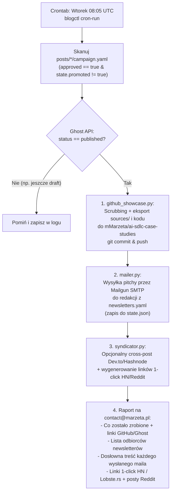

# Design Document: Blog Workspace, AI-SDLC Playbook & Automated Promotion Engine (`blog.marzeta.pl`)

- **Data:** 2026-11-14
- **Docelowy host:** Raspberry Pi 5 (`raspberrypi` / `192.0.2.10`, użytkownik `mmarzeta`, `~/projects/blog`)
- **Publiczne zasoby:** `https://blog.marzeta.pl` (Ghost 6 w Dockerze) oraz `https://github.com/mMarzeta/ai-sdlc-case-studies`

---

## 1. Cel i kontekst (Intent & Why)

Maciej Marzęta publikuje cotygodniowe, techniczne artykuły w każdy wtorek o `08:00 UTC` na self-hostowanym blogu Ghost (`https://blog.marzeta.pl`). Strategicznym celem bloga jest pełnienie roli wizytówki i twardego dowodu kompetencji (*Proof of Work*) pod role **CTO, VP of Engineering, Head of AI oraz eksperta/konsultanta AI-Native SDLC** — **bez korzystania z LinkedIna**.

Obecny stan i zidentyfikowane luki:
1. Materiały źródłowe pod posty (specki, plany wdrożenia, podsumowania czatów z AGY, dotychczasowe szkice) są rozproszone pomiędzy `~/projects/docs/superpowers/`, `~/projects/docs/bravia65-tvs/`, `~/.gemini/antigravity-cli/brain/` oraz wstępny katalog `~/projects/blog/`.
2. Najnowsze wpisy zawierają zaawansowaną inżynierię systemową i orkiestrację subagentów AI, ale w tytułach i narracji stawiają na pierwszym planie sprzęt domowy (Raspberry Pi, telewizory Sony Bravia) zamiast **metodologii AI-Native SDLC, zarządzania architekturą i mierzalnego tempa dostarczania oprogramowania**.
3. Strona `blog.marzeta.pl` ma błędy w pozycjonowaniu: podpięta w menu podstrona `/about/` (10. najczęściej odwiedzana strona wg Umami) wyświetla domyślny tekst reklamowy Ghosta, właściwe bio z 2024 roku wisi osierocone pod `/about-2/`, nawigacja pokazuje wyłącznie tagi z 2024 roku, a `meta_description` zawiera sprzeczny przekaz.
4. **Stan dotychczasowy (przed wdrożeniem):** Brakowało jakiejkolwiek automatyzacji dystrybucji. **Stan docelowy (po wdrożeniu):** Eksport kodu/specek na GitHuba, wysyłka maili (pitchy) do redakcji newsletterów oraz wysyłka raportu podsumowującego na `contact@marzeta.pl` dzieją się **w 100% automatycznie** (przez wtorkowy cron o `08:05 UTC` oraz przy publikacji). Ręcznie wykonujesz **wyłącznie** kliknięcie gotowego linku na Hacker News i wklejenie posta na Reddit z maila podsumowującego.

Projekt przekształca `~/projects/blog` w **zautomatyzowany silnik wydawniczo-promocyjny AI-SDLC**, który:
- Porządkuje wszystkie opublikowane, zaplanowane i przyszłe posty wraz z ich speckami, planami i podsumowaniami z AGY.
- Wyposaża agenta piszącego w rygorystyczny **Playbook CTO / Head of AI (`PLAYBOOK.md`)**, wymagający w każdym wpisie sekcji **"The AI-SDLC Blueprint"** (metryki LOC, liczba testów, iteracje specek/planów, podział decyzji Agent vs. Architekt) oraz konfiguracji kampanii (`campaign.yaml`).
- Automatyzuje publikację dowodów pracy na GitHubie (`mMarzeta/ai-sdlc-case-studies`), wysyłkę pitchy do redaktorów newsletterów przez Mailgun SMTP, opcjonalny cross-posting API (Dev.to/Hashnode) oraz **wysyłkę pełnego maila podsumowującego do `contact@marzeta.pl`** z listą wykonanych akcji, odbiorców i dokładną treścią wysłanych wiadomości.
- Naprawia pozycjonowanie `blog.marzeta.pl` (`/about/`, nawigacja, meta-tagi, bio autora, `/llms.txt` pod wyszukiwarki AI).

*(Uwaga: Przebudowa wizualna motywu Ghosta stanowi Etap 2 i zostanie zrealizowana po wdrożeniu Etapu 1).*

---

## 2. Cele, Non-Goals i Anti-Goals

### Cele (Goals)
1. **Spójny Workspace Blogowy (`~/projects/blog`):**
   - Konsolidacja istniejących wpisów (`cve-watchdog`, `homelab-64bit`, `bravia65-debloat`, `tv-screentime`) oraz nadchodzącego tematu (`torrent-drop`) w jednolitą strukturę katalogów `posts/<YYYY-MM-DD-slug>/`.
   - Komenda pomocnicza `blogctl ingest` do szybkiego podpinania specek, planów i artefaktów z `~/.gemini/.../brain/` do podkatalogu `sources/` danego posta.
2. **Playbook Agenta (`PLAYBOOK.md`) i kontekst (`GEMINI.md`):**
   - Zdefiniowanie struktury narracyjnej pod rekruterów C-level/CTO, obowiązkowej sekcji **"The AI-SDLC Blueprint"** oraz schematu generowania `campaign.yaml`.
3. **Narzędzie CLI (`tools/blogctl.py`) + Wtorkowy Cron (`08:05 UTC`):**
   - **Synchronizacja z Ghost Admin API:** Tworzenie i aktualizacja postów, stron i tagów przez Ghost Admin API (`http://127.0.0.1:2368/ghost/api/admin/`) z autoryzacją JWT (HS256).
   - **Synchronizacja GitHub Proof-of-Work:** Sanityzacja (`scrubber`) i eksport materiałów z `sources/` (specki, plany, podsumowania architektury) oraz wybranego kodu/testów projektu do publicznego repozytorium `git@github.com:mMarzeta/ai-sdlc-case-studies.git` w katalogu `case-studies/<YYYY-MM-DD-slug>/` wraz z automatyczną aktualizacją tabeli w głównym `README.md`.
   - **Automatyczna wysyłka pitchy do newsletterów:** Wysyłka spersonalizowanych maili przez Mailgun SMTP (`smtp.eu.mailgun.org:587`) do redakcji zdefiniowanych w `config/newsletters.yaml`.
   - **Opcjonalna syndykacja API:** Wsparcie dla publikacji na Dev.to i Hashnode z ustawionym `canonical_url` na `https://blog.marzeta.pl/<slug>/` (gdy klucze API są podane w `.env`).
   - **Raport wykonawczy na maila (`contact@marzeta.pl`):** Po każdym przebiegu promocyjnym wysyłka szczegółowego podsumowania HTML + tekst zawierającego:
     - Status każdego kroku (link do posta w Ghost, link do commita i katalogu na GitHubie, status syndykacji).
     - Dokładną listę odbiorców newsletterów (`To`, nazwa newslettera, status SMTP, znacznik czasu).
     - **Pełną, dosłowną treść (`Subject` + `Body`) każdego wysłanego maila.**
     - Gotowe linki 1-click do zgłoszenia posta na Hacker News (`news.ycombinator.com/submitlink`) i Lobste.rs oraz sformatowane posty do wklejenia na Reddit (`r/ExperiencedDevs`, `r/Python`, `r/selfhosted`, `r/LocalLLaMA`).
4. **Retrofitting istniejących postów i start kampanii już w najbliższy wtorek (`2026-11-17`) — *Decyzja użytkownika*:**
   - Dopisanie sekcji **"The AI-SDLC Blueprint"** do 3 już opublikowanych postów (`2026-10-27-cve-watchdog`, `2026-11-03-homelab-64bit`, `2026-11-10-bravia65-debloat`) oraz do posta zaplanowanego na najbliższy wtorek (`2026-11-17-tv-screentime`).
   - Natychmiastowy backfill 3 opublikowanych case studies (`cve-watchdog`, `homelab-64bit`, `bravia65-debloat`) do repozytorium `mMarzeta/ai-sdlc-case-studies` podczas wdrożenia (z oznaczeniem `pitches_sent` jako zamkniętych w `state.json`, aby nie wysyłać maili o starych postach), dzięki czemu link w nawigacji bloga od pierwszego dnia prowadzi do wypełnionego portfolio na GitHubie.
   - Przygotowanie pełnego `campaign.yaml` (`approved: true`) dla `2026-11-17-tv-screentime`, aby we wtorek **17.11 o `08:05 UTC`** cron automatycznie wypchnął jego case study na GitHuba, rozesłał pitche do newsletterów i przysłał raport na `contact@marzeta.pl`.
5. **Przebudowa pozycjonowania w Ghost (`blog.marzeta.pl`):**
   - Zastąpienie treści `/about/` stroną typu Executive Profile (CTO / Head of AI / AI-SDLC Architect) z linkami do GitHuba i kontaktem `contact@marzeta.pl`; cofnięcie duplikatu `/about-2/` do statusu `draft`.
   - Aktualizacja ustawień Ghosta (`title`, `description`, `meta_title`, `meta_description`, `navigation`, `secondary_navigation`) oraz `bio` autora.
   - Utworzenie tagów `AI-SDLC` (`ai-sdlc`) oraz `Architecture` (`architecture`) i przypisanie ich do odpowiednich wpisów.
   - Wdrożenie pliku `/llms.txt` pod crawlery AI (ChatGPT, Perplexity, Claude).

### Non-Goals (Etap 1)
- Zmiany CSS/HTML wyglądu motywu `dawn_star` (przeniesione do Etapu 2 zaraz po zamknięciu Etapu 1).
- Jakakolwiek integracja z LinkedInem.

### Anti-Goals (Czego system nigdy nie może zrobić)
- **Zakaz automatycznego wysyłania formularzy przez boty na Hacker News i Reddit:** Nigdy nie używamy skryptów/headless browserów do bezpośredniego postowania na HN/Reddit (skutkuje to natychmiastowym shadowbanem domeny `blog.marzeta.pl`).
- **Zakaz wycieku sekretów i lokalnych adresów IP na GitHuba:** Nigdy nie wypychamy plików `.env`, kluczy API, haseł, lokalnych adresów LAN (`192.168.x.x`), kluczy WireGuard ani prywatnych danych do `mMarzeta/ai-sdlc-case-studies`. W razie wykrycia wzorca klucza po sanityzacji, proces przerywa działanie przed `git commit`.
- **Zakaz duplikowania wysyłki maili:** Nigdy nie wysyłamy pitcha drugi raz dla tej samej pary `(post_slug, newsletter_id)`. Stan wysyłki jest trwale zapisywany w `posts/<dir>/state.json`.

---

## 3. Ograniczenia i decyzje techniczne (Constraints & Builder Calls)

1. **Izolacja repozytorium GitHub Showcase (*Builder Call*):**
   - Katalog `~/projects` posiada niezwiązane, lokalnie zmodyfikowane pliki konfiguracyjne (Jellyfin, Home Assistant). Aby operacje gitowe były w 100% bezpieczne i niezależne, klon publicznego repozytorium `git@github.com:mMarzeta/ai-sdlc-case-studies.git` będzie utrzymywany w `~/projects/blog/.github-showcase-repo/` (dodanym do `.gitignore` nadrzędnego repozytorium).
2. **Zero niestandardowych zależności w Pythonie (*Builder Call*):**
   - Na malince (Debian 13 `aarch64`) `blogctl` będzie korzystać wyłącznie z biblioteki standardowej Pythona 3 (`urllib.request`, `smtplib`, `email`, `hmac`, `hashlib`, `base64`, `json`, `re`, `subprocess`, `pathlib`) oraz systemowego `python3-yaml` (`PyYAML`). Dzięki temu zadanie `cron` nigdy nie wyłoży się na brakującym środowisku virtualenv.
3. **Konfiguracja nadawcy Mailgun SMTP (*Builder Call*):**
   - Maile do redakcji newsletterów oraz raporty podsumowujące będą wysyłane przez skonfigurowany na malince serwer `smtp.eu.mailgun.org:587` z nagłówkiem `From: "Maciej Marzęta" <blog@newsletter.marzeta.pl>` (domena zweryfikowana DKIM/SPF w Mailgunie) oraz `Reply-To: contact@marzeta.pl`, dzięki czemu każda odpowiedź redaktora trafi prosto na `contact@marzeta.pl`.
4. **Komunikacja z Ghost 6 Admin API (*Builder Call*):**
   - Kontener `ghost` (`ghost:6-patched`) nasłuchuje lokalnie na `127.0.0.1:2368` i wymaga nagłówka `X-Forwarded-Proto: https` (w przeciwnym razie zwraca przekierowanie `301` na zewnętrzny URL). Przy aktualizacji treści postów/stron używamy parametru `?source=html`, aby Ghost 6 automatycznie przekonwertował kod HTML na wewnętrzny format Lexical.
5. **Serwowanie `/llms.txt` (*Builder Call*):**
   - Plik `llms.txt` zostanie umieszczony w katalogu głównym aktywnego motywu `~/projects/content/themes/dawn_star/llms.txt` (po przeładowaniu kontenera Ghost serwuje pliki z roota motywu bezpośrednio pod `https://blog.marzeta.pl/llms.txt`).

---

## 4. Rozważane podejścia (Approaches)

- **Podejście A:** Monorepo-Showcase na GitHubie (`mMarzeta/ai-sdlc-case-studies`) + ręcznie wywoływane CLI `blogctl`.
  - *Kompromis:* Bezpieczne, ale wymaga ręcznego odpalania komendy w każdy wtorek rano po publikacji posta.
- **Podejście B:** Osobne repozytorium na GitHubie dla każdego wpisu blogowego.
  - *Kompromis:* Rozprasza portfolio AI-SDLC na wiele drobnych repozytoriów (szczególnie przy wpisach architektonicznych/audytowych), utrudniając rekruterowi przegląd wszystkich case studies w jednym miejscu.
- **Podejście C (Wybrane przez użytkownika):** Monorepo-Showcase `mMarzeta/ai-sdlc-case-studies` + bezobsługowy wtorkowy Cron (`08:05 UTC`) + pełny mailowy raport powykonawczy na `contact@marzeta.pl`.
  - *Uzasadnienie:* Idealnie spina się z wtorkowym harmonogramem publikacji w Ghost (`08:00 UTC`), automatyzuje cały proces dystrybucji dla zatwierdzonych wpisów (`approved: true`) i daje pełną transparentność dzięki raportowi mailowemu z dokładną treścią wysłanych wiadomości.

---

## 5. Szczegółowa architektura rozwiązania

### 5.1 Struktura katalogu `~/projects/blog`

```text
~/projects/blog/
├── .env                          # GHOST_ADMIN_API_KEY, dane SMTP, GITHUB_REPO, NOTIFY_TO (w .gitignore)
├── .env.example                  # Szablon zmiennych środowiskowych
├── .github-showcase-repo/        # Lokalny klon git@github.com:mMarzeta/ai-sdlc-case-studies.git (w .gitignore)
├── GEMINI.md                     # Techniczny opis workspace'u i komend blogctl dla agenta
├── PLAYBOOK.md                   # Wytyczne redakcyjne CTO/Head of AI, struktura AI-SDLC Blueprint i kampanii
├── config/
│   ├── newsletters.yaml          # Baza redakcji newsletterów (Python Weekly, PyCoder's, TLDR, Pointer, Changelog itd.)
│   └── scrubber_rules.yaml       # Reguły podmiany ścieżek/IP oraz wzorce blokujące wyciek sekretów
├── tools/
│   ├── blogctl.py                # Główne CLI (ingest, site-setup, ghost-sync, github-sync, pitch, promote, cron-run)
│   ├── ghost_client.py           # Klient Ghost Admin API (JWT HS256, odczyt/zapis postów, stron, tagów i ustawień)
│   ├── github_showcase.py        # Scrubber + eksporter do repozytorium mMarzeta/ai-sdlc-case-studies
│   ├── mailer.py                 # Klient Mailgun SMTP (wysyłka pitchy + generator raportu HTML/text)
│   └── syndicator.py             # Opcjonalny cross-poster (Dev.to/Hashnode) + generator linków HN/Lobste.rs/Reddit
├── tests/
│   └── test_blogctl.py           # Testy jednostkowe i integracyjne pytest
└── posts/
    ├── 2026-10-27-cve-watchdog/
    │   ├── post.md
    │   ├── sources/
    │   ├── campaign.yaml
    │   └── state.json
    ├── 2026-11-03-homelab-64bit/
    │   ├── post.md
    │   ├── sources/
    │   ├── campaign.yaml
    │   └── state.json
    ├── 2026-11-10-bravia65-debloat/
    │   ├── post.md
    │   ├── sources/
    │   ├── campaign.yaml
    │   └── state.json
    ├── 2026-11-17-tv-screentime/
    │   ├── post.md
    │   ├── sources/
    │   ├── campaign.yaml
    │   └── state.json
    └── 2026-11-24-torrent-drop/
        ├── README.md
        ├── sources/              # Specki, plany, architecture_decisions_summary.md
        ├── assets/               # Diagramy i zrzuty ekranu
        ├── campaign.yaml         # Szkielet konfiguracji kampanii pod nowy wpis
        └── state.json
```

### 5.2 Przepływ wtorkowej automatyzacji (`blogctl cron-run`)



### 5.3 Zakres aktualizacji существуjących postów i repozytorium GitHub

1. **Backfill 3 opublikowanych postów (`2026-10-27-cve-watchdog`, `2026-11-03-homelab-64bit`, `2026-11-10-bravia65-debloat`):**
   - Dopisanie na końcu każdego z nich w Ghost sekcji **"The AI-SDLC Blueprint"** z podsumowaniem użytych artefaktów, metryk i roli agenta oraz linkiem do odpowiedniego katalogu w `https://github.com/mMarzeta/ai-sdlc-case-studies`.
   - Eksport ich dokumentacji projektowej, raportów i skryptów (po sanityzacji) do `mMarzeta/ai-sdlc-case-studies/case-studies/<folder>/`.
   - Oznaczenie w ich `state.json` flagi `promoted: true` (aby wtorkowy cron nie wysyłał dla nich wstecznych pitchy mailowych).
2. **Przygotowanie wtorkowego posta (`2026-11-17-tv-screentime`):**
   - Dopisanie sekcji **"The AI-SDLC Blueprint"** do zaplanowanego posta w Ghost (`ghost_post_id: 6af089a13555710001b8a0a6`).
   - Zbudowanie pełnego `campaign.yaml` (`approved: true`, `promoted: false` w `state.json`) ze spersonalizowanymi pitchami do newsletterów Python/IoT/Self-Hosted/AI-SDLC oraz kopią na HN i Reddit.
   - We wtorek `2026-11-17 o 08:05 UTC` cron automatycznie wykona eksport tego case study na GitHuba, wyśle maile do redakcji i przyśle raport podsumowujący na `contact@marzeta.pl`.

---

## 6. Kwestie pozostawione do decyzji implementacyjnej (Left to the Builder)

- Dokładny układ wizualny HTML maila z raportem podsumowującym (czytelny szablon z inline CSS, tabelą odbiorców i blokami `<pre>` prezentującymi dokładną treść wysłanych wiadomości).
- Ergonomia flag wiersza poleceń w `blogctl.py` (w tym obowiązkowa flaga `--dry-run` pozwalająca przetestować cały przepływ i podejrzeć raport bez wysyłania zewnętrznych maili).
